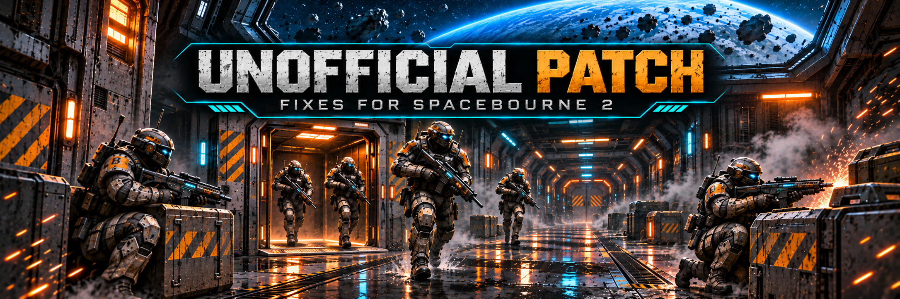

# Unofficial Patch — fixes for SpaceBourne 2's own bugs

SpaceBourne 2 has bugs in its AI that have nothing to do with mods: allies appear half under the
floor or outside the lift and open fire, enemies come out of a lift and ignore you, squad
soldiers turn and shoot in the same instant, and a few smaller ones. The Unofficial Patch fixes
them. Every fix is a switch in `config.lua`, on by default, and each one steps aside when another
mod of the realism set already fixes the same thing.

**Links:** [GitHub](https://github.com/hubertdungen/SpaceBourne2-UnofficialPatch) · UE4SS Lua mod ·
works alone or with the rest of the realism set.
**Install the whole realism set in one go:** the
[SpaceBourne 2 Realism installer](https://github.com/hubertdungen/SpaceBourne2-Realism)
([Nexus](https://www.nexusmods.com/spacebourne2/mods/11)).

## Features

### Allies and lifts

- **Allies line up in the lift.** The game puts each ally on one of two fixed points of the lift,
  at floor level and without checking anything: the third one gets no point, and they stand in each
  other, half in the floor or outside the cabin. After a lift ride or a new dungeon floor the patch
  puts every ally that follows you on a spot it checked first: a clear line from you, a floor at
  your height under it, free of anyone else, and inside the cabin while you are in one.
- **Allies are checked after every load.** The game's own placing at a load can leave soldiers in or under
  the floor (seen on a test save: three of four squad soldiers, one 11 m below the level). A few seconds
  after each load the patch checks the squad and puts them next to you.
- **The catch-up teleport can't bury anyone.** When a squad soldier is more than 30 m away the game
  drops it on a random point around you without looking at walls or floor. The patch checks each
  soldier after that (and after any jump of yours over 15 m): one in the floor, behind a wall or
  outside the lift is moved to a checked spot next to you.
- **Allies that just arrived hold fire for a moment** (1.5 s), so they don't shoot the instant they
  appear.

### Enemies

- **Enemies out of a lift stop ignoring you.** An enemy sent to a spot outside a lift walks there
  blind (both its eyes off) and deaf (the flag that makes every alert and every hit do nothing),
  and only gets its senses back once it is within 2 m of that spot. One that never gets there stays
  blind and deaf for good. After 3 s without getting closer (or 12 s in all, or once it is hit) the
  patch gives it what the game gives on arrival: eyes on, hearing back, combat behaviour started.

### Squad fire

- **Reaction time for the squad.** A squad soldier picks a target, aims and fires in one call.
  Now the first shot at a new target waits for a reaction time by tier (0.7 s for rookies down to
  0.35 s for veterans), then the soldier fires with the game's own function.
- **Allies don't fire at enemies that aren't active yet.** Allies "see" an enemy the moment it spawns,
  even before it is awake, and open fire. Rounds fired at a shooter that is not ready, or that
  showed up less than 1.5 s ago, are removed, and the allies shoot once it is active. Blind (eyes off) alone does not count
  (0.1.0 counted it, and with Silent Ops, which blinds every enemy that has not noticed anyone, the squad's rounds never
  reached them).
  A boss gets 5 s (its spawn intro) before allies may fire at it; without this a boss can die the moment it appears.
- **No shots through you.** A round of a squad soldier or companion that would pass through you
  before it reaches its target is removed.

### Fixes taken from other mods of the set

Applied only while the mod that has them is off or too old; otherwise that mod does it and the
patch skips it (the log says so at start):

- **Frozen bullets after a hit** (the load crash after a long firefight): from
  [Hardcore Tactical Realism](https://www.nexusmods.com/spacebourne2/mods/4).
- **Companions' bullets that did nothing** (they lived 0 s): from Hardcore Tactical Realism.
- **Squad runs and sprints to keep up** instead of walking and teleporting: from Hardcore Tactical Realism.
- **HUD spare-ammo count after a pickup:** from Ammo Discipline.

## Works with the set

At start the patch reads `Mods\mods.txt` and the owner mods' versions and settings. It publishes
what it does in the shared variable `SB2R_GameFixes`, so a later version of another mod can hand a
fix over. Nothing is fixed twice.

**Silent Ops:** use 0.1.1 or later. 0.1.0 counted "eyes off" as "not active yet", and Silent Ops switches the eyes of
every enemy that has not noticed anyone off, so the squad's rounds at them were removed for good. (Workaround on 0.1.0:
`DormantTargets = false`.)

## Install

Copy the `UnofficialPatch` folder to `SB2\Binaries\Win64\Mods\` (it needs
[UE4SS](https://github.com/UE4SS-RE/RE-UE4SS) 3.0.1 installed, as the other mods of the set) or use the
realism installer. It starts with the game.

## Settings

`Mods\UnofficialPatch\scripts\config.lua` (Notepad, restart the game): every fix on/off, the squad
reaction times, how long a stuck enemy waits, how far an ally may be before it is brought along.
`Debug = { Log = true }` writes `UnofficialPatch\unofficialpatch.log`.

## Not fixed (yet)

- NPC groups far from you stay idle: the game's AI is built around your position. Under study.

## Notes

Everything the patch touches is named in `scripts/up/gamedefs.lua`: after a game update, that is the
file to check. The patch runs all its timed work on the game thread and never uses UE4SS's
background loops (`LoopAsync`, `ExecuteWithDelay`), like the rest of the set.

MIT licence, see [LICENSE](LICENSE).

<a href="https://dlforge.dungenlabs.com"><picture><source media="(prefers-color-scheme: dark)" srcset="docs/branding/dlforge-logo-negative.svg"></picture></a>

